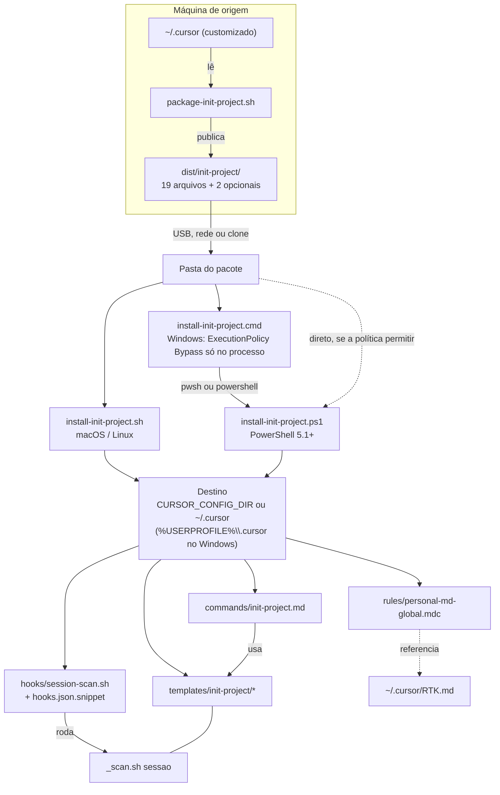
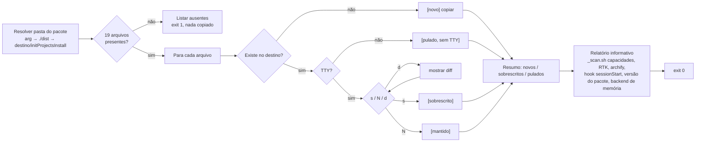
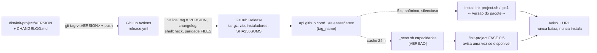
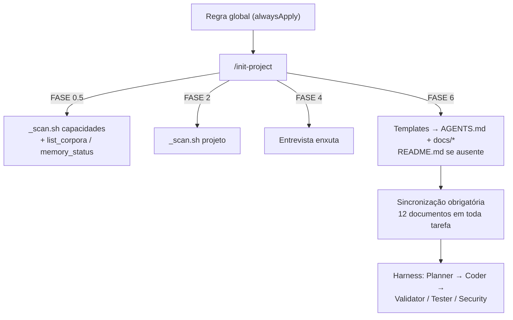

# Organograma — Personal-MD-for-Cursor

Última atualização: 2026-10-15

## Relação entre as peças

## O que acontece dentro de um instalador

## Versão, release e aviso de atualização

`PERSONAL_MD_NO_UPDATE_CHECK=1` corta as duas linhas pontilhadas. Atualizar continua sendo rodar o instalador com a pasta da release extraída.

## Como o pacote governa um projeto

Os instaladores não decidem o que o `/init-project` faz: eles só colocam a regra, o comando, os templates e o hook no lugar certo. O `.cmd` não decide o que copiar — só inicia o PowerShell. O `.ps1` não substitui o `_scan.sh`; no Windows a varredura depende de Git Bash ou WSL.

## Histórico

| Data | Alteração |
| --- | --- |
| 2026-10-06 | Versão original no repositório irmão (Claude Code), em ASCII, com o ramo `.cmd`. |
| 2026-10-15 | Reescrito em Mermaid para o Cursor: destino `~/.cursor`/`CURSOR_CONFIG_DIR`, sem `.cmd`, diagrama interno do instalador e diagrama de governança. |
| 2026-10-15 | Ramo Windows ganha o lançador `install-init-project.cmd` → `.ps1`. |
| 2026-10-15 | 19 arquivos; relatório do instalador inclui versão do pacote; novo diagrama "Versão, release e aviso de atualização". |
